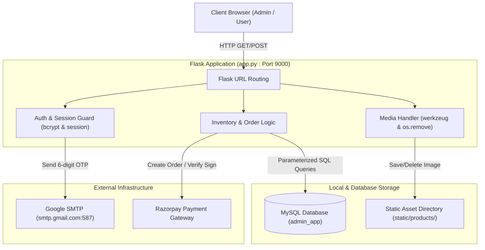

# E-Commerce Admin Management System

[](https://github.com/bhavanajoseph84392-png/E-Commerce-/blob/main/E-Commerce_Admin_Management_System_Documentation.pdf)
[](https://github.com/bhavanajoseph84392-png/E-Commerce-/raw/main/E-Commerce_Admin_Management_System_Documentation.pdf)
[](./ARCHITECTURE.md)
[](https://www.python.org/)
[](https://flask.palletsprojects.com/)
[](https://www.mysql.com/)

A full-stack Flask web application backed by MySQL for e-commerce inventory management, role-based administration, automated email verification, and catalog maintenance. The application provides an admin portal for product lifecycle management (CRUD, dynamic search, category filtering, file cleanup) alongside user store-front and order workflows with Razorpay integration.

---

## 📖 Project Documentation (Quick Access)

> [!TIP]
> **Complete 18-page Project Documentation is available in this repository.** Anyone can view it online or download it using the clickable links below:

| Resource | Format | Direct Clickable Link | Description |
| :--- | :---: | :--- | :--- |
| **Full Project Documentation** | 📄 `PDF` (18 Pages) | [👉 **Click Here to Open Documentation (PDF)**](https://github.com/bhavanajoseph84392-png/E-Commerce-/blob/main/E-Commerce_Admin_Management_System_Documentation.pdf) | Complete report covering architecture, workflows, database schema, security, and viva FAQ. |
| **Direct File Download** | 💾 `PDF` (643 KB) | [📥 **Click Here to Download Documentation**](https://github.com/bhavanajoseph84392-png/E-Commerce-/raw/main/E-Commerce_Admin_Management_System_Documentation.pdf) | Direct raw download link for offline viewing and printing. |
| **Repository File Link** | 📁 `PDF` | [📄 `./E-Commerce_Admin_Management_System_Documentation.pdf`](./E-Commerce_Admin_Management_System_Documentation.pdf) | Relative link for local clones and repository browser. |
| **System Architecture Guide** | 📑 `Markdown` | [🏛️ **Read ARCHITECTURE.md**](./ARCHITECTURE.md) | Component architecture, directory structure, and request flow walkthrough. |
| **Main Application File** | 🐍 `Python` | [🚀 **View app.py**](./app.py) | Monolithic backend service with admin & customer routes. |

---

## 📑 Table of Contents
- [📖 Project Documentation (Quick Access)](#-project-documentation-quick-access)
- [1. Project Overview & Objectives](#1-project-overview--objectives)
- [2. Problem Statement & Key Solutions](#2-problem-statement--key-solutions)
- [3. Implemented Features & Actual Behavior](#3-implemented-features--actual-behavior)
- [4. Technology Stack](#4-technology-stack)
- [5. System Architecture & Request Flow](#5-system-architecture--request-flow)
- [6. Repository Structure](#6-repository-structure)
- [7. Windows Installation & Environment Setup](#7-windows-installation--environment-setup)
- [8. Environment Variables & Configuration](#8-environment-variables--configuration)
- [9. MySQL Database Setup & Verified Schema](#9-mysql-database-setup--verified-schema)
- [10. Application Startup Commands](#10-application-startup-commands)
- [11. Flask Routes and HTTP Methods](#11-flask-routes-and-http-methods)
- [12. Product Inventory CRUD & Cleanup Mechanics](#12-product-inventory-crud--cleanup-mechanics)
- [13. Admin Registration & Email OTP Workflow](#13-admin-registration--email-otp-workflow)
- [14. Password Hashing & Session-Based Authentication](#14-password-hashing--session-based-authentication)
- [15. Input Validation & Error Handling](#15-input-validation--error-handling)
- [16. Manual Testing Checklist](#16-manual-testing-checklist)
- [17. Known Limitations & Future Improvements](#17-known-limitations--future-improvements)
- [18. Troubleshooting Guide](#18-troubleshooting-guide)
- [19. Security Considerations & Safeguards](#19-security-considerations--safeguards)
- [20. Learning Outcomes & Technical Challenges](#20-learning-outcomes--technical-challenges)
- [21. Interview Preparation & Technical FAQ](#21-interview-preparation--technical-faq)

---

## 1. Project Overview & Objectives

Managing product inventories, digital assets, and transactions requires data consistency, authenticated access controls, and synchronized file management. The **E-Commerce Admin Management System** addresses these needs by combining a Python/Flask backend with a relational MySQL database.

### Core Objectives
- **Secure Administrator Access**: Multi-factor email One-Time Password (OTP) validation via SMTP, `bcrypt` password hashing, and server-side session management.
- **Product Inventory Lifecycle**: Full CRUD operations over products with stock tracking, price management, and category assignment.
- **Physical Media Synchronization**: Validate uploaded images, store them on disk, and automatically delete (`os.remove`) files upon product deletion or image replacement to prevent orphaned storage bloat.
- **Catalog Navigation**: Fast product discovery through SQL pattern matching (`LIKE`) across names and descriptions, combined with category filtering.
- **End-to-End Store Operations**: Customer registration, cart management, checkout with Razorpay payment processing, and admin order monitoring.

---

## 2. Problem Statement & Key Solutions

| Challenge | Impact | Implemented Solution |
| :--- | :--- | :--- |
| **Orphaned Media Files** | Deleting product records leaves orphaned files consuming server disk space. | Synchronized filesystem deletion via `os.remove()` within both delete and image replacement routes. |
| **Unauthorized Admin Registration** | Bot signups or unauthorized admin accounts. | Enforced two-step registration gate: saved with `is_verified = FALSE`, unlocked only after valid 6-digit email OTP submission. |
| **Password Vulnerabilities** | Plaintext or weakly hashed credentials exposed in breaches. | Salted password hashing via `bcrypt.hashpw()` and verification via `bcrypt.checkpw()`. |
| **Inventory Desynchronization** | Customers ordering items that are out of stock. | Conditional SQL updates (`stock = stock - %s WHERE stock >= %s`) during payment verification for atomic stock decrement. |

---

## 3. Implemented Features & Actual Behavior

### Admin Authentication & Security
- **Registration (`/admin/register`)**: Captures name, email, password. Hashes password using `bcrypt`, generates a random 6-digit OTP with 5-minute expiry, stores record with `is_verified = 0`, and sends OTP via Gmail SMTP (`smtplib.SMTP`).
- **OTP Verification (`/admin/verify-otp`)**: Compares submitted code and timestamp against database. On match, sets `is_verified = 1` and clears OTP fields.
- **Session-Based Login (`/admin/login`)**: Verifies admin exists, is verified, and supplied password matches `bcrypt` hash. Stores `admin_id`, `admin_name`, and `admin_email` in `session`.
- **Profile Management (`/admin/profile`)**: Displays account details, allows name/email updates, and profile avatar uploads.
- **Logout (`/admin/logout`)**: Clears admin session keys and redirects to login.

### Product Inventory Management
- **Add Product (`/admin/products/add`)**: Validates inputs and extensions (`jpg`, `jpeg`, `png`, `gif`, `webp`). Generates a timestamped filename (`product_YYYYMMDDHHMMSSffffff.ext`), saves file to `static/products/`, and inserts record into MySQL.
- **Catalog & Search (`/admin/products`)**: Displays inventory table. Supports search across name and description (`LIKE`), plus dropdown filtering from dynamic `DISTINCT category` SQL queries.
- **View Product Details (`/admin/products/<id>`)**: Shows full product metadata and high-resolution image.
- **Update Product (`/admin/products/update/<id>`)**: Updates text fields (name, description, price, category, stock).
- **Replace Image (`/admin/products/replace-image/<id>`)**: Uploads new image, updates database, and deletes old image via `os.remove()`.
- **Delete Product (`/admin/products/delete/<id>`)**: Deletes database record and unlinks associated image via `os.remove()`.

### Customer Portal & Order Management
- **User Authentication (`/user/register`, `/user/verify-otp`, `/user/login`)**: Parallel customer onboarding workflow with email OTP verification.
- **Cart & Checkout (`/user/cart`, `/user/checkout`)**: Item quantity management, subtotal calculation, and checkout review.
- **Razorpay Integration (`/user/create-payment-order`, `/user/verify-payment`)**: Razorpay order generation and HMAC signature verification. On success, deducts stock and converts cart items into order records.
- **Admin Order Inspection (`/admin/orders`, `/admin/orders/<id>`)**: Lists incoming customer orders with status filters and customer details, allowing status updates (`Placed`, `Shipped`, `Delivered`).

---

## 4. Technology Stack

| Layer | Technology | Rationale & Code Usage |
| :--- | :--- | :--- |
| **Backend Framework** | **Flask (3.1.x)** | Lightweight WSGI micro-framework providing modular routing, session cookies, and Jinja2 rendering. |
| **Language** | **Python (3.10+)** | Application logic, file system operations (`os`, `werkzeug`), and standard libraries (`smtplib`, `datetime`). |
| **Database** | **MySQL Server** | Relational storage ensuring data integrity across users, products, carts, and order items. |
| **DB Connector** | **`mysql-connector-python`** | Official MySQL driver providing parameterized queries (`%s`) to protect against SQL injection. |
| **Security & Hashing** | **`bcrypt`** | Slow hashing algorithm with per-password salting against rainbow table attacks. |
| **Mailing / OTP** | **`smtplib` & `email.message`** | Built-in Python networking modules communicating over port 587 with STARTTLS encryption. |
| **Payment Gateway** | **`razorpay`** | Python SDK managing order initialization and payment signature verification. |
| **Frontend Templates** | **Jinja2 / HTML5 / CSS3** | Server-side template rendering for dynamic admin tables, modals, and product grids. |
| **Frontend (Optional)**| **React + Vite (`frontend/`)**| Optional SPA configured in `ReactApp.py` with CORS support for headless deployment. |

---

## 5. System Architecture & Request Flow



### Request Flow Walkthrough (Product Deletion Example)
1. **Admin Request**: Authenticated admin clicks "Delete" on `/admin/products`, submitting `POST /admin/products/delete/<product_id>`.
2. **Session Verification**: Flask checks `session.get("admin_id")`. If missing, redirects to `/admin/login`.
3. **Record Lookup**: Queries MySQL `SELECT image FROM products WHERE product_id = %s`.
4. **Database Purge**: Executes `DELETE FROM products WHERE product_id = %s` and commits transaction.
5. **Disk Cleanup**: Resolves image path in `app.config["PRODUCT_UPLOAD_FOLDER"]`. If file exists, executes `os.remove(image_path)`.
6. **Client Redirect**: Returns `302 Redirect` to `/admin/products`, rendering the updated catalog.

---

## 6. Repository Structure

```text
C:\flask\E-Commerce\
├── .env                       # Environment configuration (ignored in git)
├── .gitignore                  # Git exclusion rules (__pycache__, uploads, venv)
├── ARCHITECTURE.md            # Architectural notes and component overview
├── E-Commerce_Admin_Management_System_Documentation.pdf # Complete 18-page project documentation report
├── README.md                  # Complete project documentation
├── requirements.txt           # Python package dependencies
├── app.py                     # Main Flask application (Admin + User monolithic server)
├── ReactApp.py                # Alternate Flask backend with CORS & React build serving
├── invoices/                  # Output directory for customer invoice generation
├── static/
│   ├── products/              # Uploaded product catalog images
│   └── uploads/               # Admin and user avatar image uploads
├── templates/                 # Jinja2 HTML templates
│   ├── add_product.html       # Add product form with image upload
│   ├── admin_dashboard.html   # Admin overview with metric counters
│   ├── admin_login.html       # Admin login interface
│   ├── admin_orders.html      # Admin order list and status manager
│   ├── admin_profile.html     # Admin profile details and avatar updater
│   ├── admin_register.html    # Admin registration form
│   ├── product_view.html      # Detailed single-product view
│   ├── products.html          # Product catalog table with search and filters
│   ├── update_product.html    # Product metadata update form
│   ├── user_cart.html         # User shopping cart interface
│   ├── user_checkout.html     # User checkout and Razorpay payment UI
│   ├── user_dashboard.html    # Customer home catalog
│   ├── user_login.html        # Customer authentication view
│   ├── user_orders.html       # Customer historical order view
│   ├── user_register.html     # Customer registration form
│   └── verify_otp.html        # Admin 6-digit OTP verification interface
└── frontend/                  # Optional React/Vite frontend source
```

---

## 7. Windows Installation & Environment Setup

### Prerequisites
- **Python 3.10+** (Added to Windows PATH)
- **MySQL Community Server 8.0+**
- **Git for Windows**

### Setup Steps
```powershell
# 1. Navigate to project root
cd C:\flask\E-Commerce

# 2. Allow script execution for virtual environment (if restricted)
Set-ExecutionPolicy -ExecutionPolicy RemoteSigned -Scope CurrentUser

# 3. Create virtual environment
python -m venv venv

# 4. Activate virtual environment
.\venv\Scripts\Activate.ps1

# 5. Install dependencies
python -m pip install --upgrade pip
pip install -r requirements.txt
```

---

## 8. Environment Variables & Configuration

Create a `.env` file in `C:\flask\E-Commerce\.env` using the following placeholders:

```env
# Flask Secret Key
SECRET_KEY=your_strong_random_secret_key_here

# MySQL Database Configuration
DB_HOST=localhost
DB_USER=root
DB_PASSWORD=your_mysql_password_here
DB_NAME=admin_app

# SMTP Gmail Configuration (requires 16-character Google App Password)
SENDER_EMAIL=your_email@gmail.com
SENDER_PASSWORD=your_16_char_gmail_app_password

# Razorpay Test Credentials (from dashboard.razorpay.com)
RAZORPAY_KEY_ID=rzp_test_your_key_id_here
RAZORPAY_KEY_SECRET=your_razorpay_key_secret_here
```

> [!WARNING]
> Never commit `.env` or real credentials to version control. Keep `.env` listed in `.gitignore`.

---

## 9. MySQL Database Setup & Verified Schema

Log in to MySQL and initialize the database schema verified against `app.py`:

```sql
CREATE DATABASE IF NOT EXISTS admin_app;
USE admin_app;

-- 1. Admins Table
CREATE TABLE IF NOT EXISTS admins (
    admin_id INT AUTO_INCREMENT PRIMARY KEY,
    name VARCHAR(100) NOT NULL,
    email VARCHAR(100) NOT NULL UNIQUE,
    password VARCHAR(255) NOT NULL,
    otp VARCHAR(10) DEFAULT NULL,
    otp_expiry DATETIME DEFAULT NULL,
    is_verified BOOLEAN DEFAULT FALSE,
    profile_image VARCHAR(255) DEFAULT NULL
);

-- 2. Products Table
CREATE TABLE IF NOT EXISTS products (
    product_id INT AUTO_INCREMENT PRIMARY KEY,
    name VARCHAR(255) NOT NULL,
    description TEXT DEFAULT NULL,
    price DECIMAL(10, 2) NOT NULL,
    category VARCHAR(100) NOT NULL,
    stock INT NOT NULL DEFAULT 0,
    image VARCHAR(255) DEFAULT NULL
);

-- 3. Customers / Users Table
CREATE TABLE IF NOT EXISTS users (
    user_id INT AUTO_INCREMENT PRIMARY KEY,
    name VARCHAR(100) NOT NULL,
    email VARCHAR(100) NOT NULL UNIQUE,
    password VARCHAR(255) NOT NULL,
    otp VARCHAR(10) DEFAULT NULL,
    otp_expiry DATETIME DEFAULT NULL,
    is_verified BOOLEAN DEFAULT FALSE,
    profile_image VARCHAR(255) DEFAULT NULL
);

-- 4. Cart Table
CREATE TABLE IF NOT EXISTS cart (
    cart_id INT AUTO_INCREMENT PRIMARY KEY,
    user_id INT NOT NULL,
    product_id INT NOT NULL,
    quantity INT NOT NULL DEFAULT 1,
    FOREIGN KEY (user_id) REFERENCES users(user_id) ON DELETE CASCADE,
    FOREIGN KEY (product_id) REFERENCES products(product_id) ON DELETE CASCADE
);

-- 5. Orders Table
CREATE TABLE IF NOT EXISTS orders (
    order_id INT AUTO_INCREMENT PRIMARY KEY,
    user_id INT NOT NULL,
    total_amount DECIMAL(10, 2) NOT NULL,
    status VARCHAR(50) DEFAULT 'Pending',
    payment_status VARCHAR(50) DEFAULT 'Pending',
    razorpay_order_id VARCHAR(100) DEFAULT NULL,
    razorpay_payment_id VARCHAR(100) DEFAULT NULL,
    razorpay_signature VARCHAR(255) DEFAULT NULL,
    created_at DATETIME DEFAULT CURRENT_TIMESTAMP,
    FOREIGN KEY (user_id) REFERENCES users(user_id)
);

-- 6. Order Line Items Table
CREATE TABLE IF NOT EXISTS order_items (
    order_item_id INT AUTO_INCREMENT PRIMARY KEY,
    order_id INT NOT NULL,
    product_id INT NOT NULL,
    quantity INT NOT NULL,
    price DECIMAL(10, 2) NOT NULL,
    FOREIGN KEY (order_id) REFERENCES orders(order_id) ON DELETE CASCADE,
    FOREIGN KEY (product_id) REFERENCES products(product_id)
);
```

---

## 10. Application Startup Commands

Ensure MySQL is running, then start the Flask server:

```powershell
python app.py
```

### Verified Server Output & Port
As configured in `app.py` (`app.run(debug=True, port=9000)`), the application starts on **port 9000**:
- **Admin Portal**: [http://127.0.0.1:9000/admin/login](http://127.0.0.1:9000/admin/login)
- **User Portal**: [http://127.0.0.1:9000/user/login](http://127.0.0.1:9000/user/login)

*(Note: Running `python ReactApp.py` also listens on port 9000 with CORS enabled for a Vite dev server on port 5173).*

---

## 11. Flask Routes and HTTP Methods

### Administrator Endpoints
| Route | Method | Access | Behavior |
| :--- | :--- | :--- | :--- |
| `/admin/register` | `GET`, `POST` | Public | Registers admin, generates `bcrypt` hash, sends email OTP. |
| `/admin/verify-otp` | `GET`, `POST` | Public | Validates 6-digit OTP and expiry timestamp; updates `is_verified=1`. |
| `/admin/login` | `GET`, `POST` | Public | Verifies bcrypt password hash; creates session. |
| `/admin/dashboard` | `GET` | Admin Session | Aggregates product counts, users, orders, and total revenue. |
| `/admin/products` | `GET` | Admin Session | Renders inventory table; filters by `search` and `category`. |
| `/admin/products/add` | `GET`, `POST` | Admin Session | Validates image, saves to `static/products/`, inserts product record. |
| `/admin/products/<id>` | `GET` | Admin Session | Displays single-product details and full-resolution image. |
| `/admin/products/update/<id>` | `GET`, `POST` | Admin Session | Updates product text fields in MySQL. |
| `/admin/products/replace-image/<id>`| `POST` | Admin Session | Saves new image and deletes previous image via `os.remove()`. |
| `/admin/products/delete/<id>` | `POST` | Admin Session | Deletes database row and unlinks image file via `os.remove()`. |
| `/admin/profile` | `GET` | Admin Session | Renders admin profile page. |
| `/admin/profile/update` | `POST` | Admin Session | Updates admin name and email. |
| `/admin/profile/image` | `POST` | Admin Session | Uploads admin avatar to `static/uploads/`. |
| `/admin/orders` | `GET` | Admin Session | Lists all orders with status/payment filters. |
| `/admin/orders/<id>` | `GET` | Admin Session | Displays order line items and pricing breakdown. |
| `/admin/orders/<id>/status` | `POST` | Admin Session | Updates order status (`Placed`, `Shipped`, `Delivered`). |
| `/admin/users` | `GET` | Admin Session | Lists registered customers with their order counts. |
| `/admin/logout` | `GET` | Authenticated | Clears admin session keys and redirects to login. |

### Customer Endpoints
| Route | Method | Access | Behavior |
| :--- | :--- | :--- | :--- |
| `/user/register` | `GET`, `POST` | Public | Customer registration with email OTP dispatch. |
| `/user/verify-otp` | `GET`, `POST` | Public | Verifies customer OTP and activates account. |
| `/user/login` | `GET`, `POST` | Public | Customer login and session initialization. |
| `/user/dashboard` | `GET` | User Session | Customer product browsing catalog. |
| `/user/cart` | `GET` | User Session | Views current cart contents and total. |
| `/user/cart/add/<id>` | `POST` | User Session | Adds item to cart or increments quantity. |
| `/user/checkout` | `GET` | User Session | Cart checkout review. |
| `/user/create-payment-order` | `POST` | User Session | Initializes Razorpay payment order. |
| `/user/verify-payment` | `POST` | User Session | Validates payment signature, decrements stock, records order. |
| `/user/orders` | `GET` | User Session | Lists customer historical orders. |
| `/user/logout` | `GET` | Authenticated | Clears user session. |

---

## 12. Product Inventory CRUD & Cleanup Mechanics

### Dynamic Search and Filtering
In `/admin/products`:
```python
search = request.args.get("search", "").strip()
category = request.args.get("category", "").strip()

query = "SELECT * FROM products WHERE 1 = 1"
values = []

if search:
    query += " AND (name LIKE %s OR description LIKE %s)"
    search_value = f"%{search}%"
    values.extend([search_value, search_value])

if category:
    query += " AND category = %s"
    values.append(category)

query += " ORDER BY product_id DESC"
cursor.execute(query, tuple(values))
```

### Media Cleanup Logic
```python
# Upon product deletion:
image_name = product["image"]
if image_name:
    image_path = os.path.join(app.config["PRODUCT_UPLOAD_FOLDER"], image_name)
    if os.path.exists(image_path):
        os.remove(image_path)
```
- **Allowed Extensions**: `{"jpg", "jpeg", "png", "gif", "webp"}` checked via `allowed_product_image()`.
- **Unique Naming**: Formatted as `product_{datetime.now().strftime('%Y%m%d%H%M%S%f')}.{ext}` via `secure_filename()` to prevent name collisions.

---

## 13. Admin Registration & Email OTP Workflow

1. **Submission**: User submits details on `/admin/register`.
2. **Password Hashing**: Salted hash computed using `bcrypt.hashpw(password.encode("utf-8"), bcrypt.gensalt())`.
3. **OTP Generation**: Numeric 6-digit OTP created via `random.randint(100000, 999999)` with `otp_expiry = datetime.now() + timedelta(minutes=5)`.
4. **Database Storage**: Saved to `admins` with `is_verified = False`.
5. **Email Dispatch**: Dispatched through Gmail SMTP (`smtp.gmail.com`, port 587) using `smtplib` and `STARTTLS`.
6. **Verification (`/admin/verify-otp`)**: Validates submitted OTP and timestamp. On match, sets `is_verified = TRUE`, clears OTP fields, and redirects to login.

---

## 14. Password Hashing & Session-Based Authentication

- **Hashing**: `bcrypt` automatically incorporates a salt and cost factor, protecting against dictionary and rainbow table attacks.
- **Verification**: Verified using `bcrypt.checkpw(password.encode("utf-8"), admin["password"].encode("utf-8"))`.
- **Session Protection**: Protected views check session state:
  ```python
  if "admin_id" not in session:
      return redirect(url_for("admin_login"))
  ```

---

## 15. Input Validation & Error Handling

- **SQL Injection Prevention**: All queries use parameterized inputs (`%s`). No string formatting is used in SQL queries.
- **Path Converters**: Flask URL converters (`<int:product_id>`) enforce numeric route parameters.
- **Extension Filtering**: Disallowed upload types are rejected with an explicit error before file creation.
- **Stock Guards**: Conditional SQL updates (`WHERE stock >= %s`) prevent negative inventory during high-concurrency checkouts.

---

## 16. Manual Testing Checklist

- [ ] **Admin Registration**: Submit `/admin/register`, verify receipt of 6-digit email OTP within 5 minutes.
- [ ] **Expired OTP**: Attempt verification after 5 minutes; verify rejection.
- [ ] **Admin Login**: Log in with verified credentials; verify redirect to dashboard.
- [ ] **Route Guard**: Open `/admin/products` in an incognito window; confirm redirect to `/admin/login`.
- [ ] **Add Product**: Upload a `.jpg` image; confirm the product appears in the table and the file exists in `static/products/`.
- [ ] **Search & Filter**: Search by keyword; verify that only matching products appear.
- [ ] **Replace Image**: Upload a replacement image; confirm that the old image is deleted from `static/products/`.
- [ ] **Delete Product**: Delete a product; verify that the database row and its image file are both removed.
- [ ] **Stock Decrement**: Purchase an item as a user; confirm that product `stock` is decremented in MySQL.

---

## 17. Known Limitations & Future Improvements

| Current Implementation | Known Limitation | Recommended Improvement |
| :--- | :--- | :--- |
| **Connection Per Request** | `get_db_connection()` opens a new connection on every request. | Implement connection pooling with SQLAlchemy or `mysql.connector.pooling`. |
| **Monolithic File** | `app.py` contains all routes and business logic (~2,000 lines). | Refactor into modular Blueprints (`admin`, `user`, `api`). |
| **Synchronous Email** | `send_otp()` blocks HTTP requests during SMTP TLS negotiation. | Offload email sending to a background task queue (Celery or Redis Queue). |
| **Local File Storage** | Images are stored on the local server filesystem. | Use cloud object storage (AWS S3, Cloudflare R2) with CDN delivery. |
| **Hardcoded Fallbacks** | Default secrets and database credentials embedded in code. | Strictly mandate environment variables via `os.environ[...]`. |

---

## 18. Troubleshooting Guide

### 1. `mysql.connector.errors.ProgrammingError: 1045 (28000): Access denied for user 'root'@'localhost'`
- **Cause**: Incorrect MySQL password in `.env` or `get_db_connection()`.
- **Fix**: Verify your local MySQL root password and ensure `DB_PASSWORD` in `.env` matches your MySQL installation.

### 2. `smtplib.SMTPAuthenticationError: (535, '5.7.8 Username and Password not accepted')`
- **Cause**: Using a regular Gmail password instead of a Google App Password.
- **Fix**: Enable 2-Step Verification in your Google Account, generate a 16-character **App Password**, and use it for `SENDER_PASSWORD`.

### 3. `PermissionError: [WinError 32] The process cannot access the file`
- **Cause**: An open process (e.g., Windows Photos, file previewer) is locking the image during deletion.
- **Fix**: Close open image previews and retry.

### 4. `FileNotFoundError: [WinError 3] The system cannot find the path specified: '...\\static\\products'`
- **Cause**: The upload directory does not exist.
- **Fix**: Ensure write permissions; `app.py` includes `os.makedirs(app.config["PRODUCT_UPLOAD_FOLDER"], exist_ok=True)`.

---

## 19. Security Considerations & Safeguards

- **SQL Injection**: Prevented via parameterized queries (`cursor.execute(sql, tuple)`).
- **Credential Storage**: Passwords hashed with salted `bcrypt`.
- **Session Security**: Session signed using `app.secret_key`. In production, enable `SESSION_COOKIE_HTTPONLY`, `SESSION_COOKIE_SECURE`, and `SESSION_COOKIE_SAMESITE = 'Lax'`.
- **Upload Restrictions**: Strict extension checking and sanitization using `secure_filename()`.

---

## 20. Learning Outcomes & Technical Challenges

- **Full-Stack Coordination**: Synchronized relational database state with physical filesystem media assets.
- **Multi-Factor Onboarding**: Designed and implemented email OTP verification with automated timestamp expiration.
- **Payment Verification**: Handled cryptographic payment signature verification using Razorpay's HMAC SHA256 utilities.
- **Defensive File Handling**: Solved file collision and orphan storage issues using unique timestamping and systematic cleanup hooks.

---

## 21. Interview Preparation & Technical FAQ

### 60-Second Elevator Pitch
> *"I developed an E-Commerce Admin Management System using Python, Flask, and MySQL. It features a complete product inventory management suite with full CRUD operations, category filtering, and keyword search. On the security side, I implemented admin onboarding using salted bcrypt password hashing, session-based login, and multi-factor email OTP verification with automated 5-minute expiry via SMTP. A key engineering detail was keeping the database synchronized with physical disk storage: whenever a product is deleted or its image is replaced, the backend automatically unlinks and removes the old image file to prevent orphaned storage waste. I also integrated customer cart workflows, order tracking, and Razorpay payment verification."*

### Technical Walkthrough
1. **Request Intake**: HTTP traffic arrives at Flask on port 9000.
2. **Session Gate**: Server checks `session.get("admin_id")` before granting access to `/admin/*` routes.
3. **Database Transactions**: Operations use parameterized queries via `mysql-connector-python` across 6 tables (`admins`, `products`, `users`, `cart`, `orders`, `order_items`).
4. **File Pipeline**: Files undergo extension validation, unique timestamp-based renaming, and disk storage in `static/products/`.
5. **Cleanup Lifecycle**: Deletion triggers atomic database deletion followed by physical file removal via `os.remove()`.

---

### 15 Common HR & Technical Interview Questions & Answers

#### Q1: Why did you choose Flask instead of Django for this project?
**Answer**: Flask provides a lightweight, minimalist architecture that gives complete control over component selection. Since I wanted to implement custom database connections with `mysql-connector-python`, custom `bcrypt` authentication, and tailored file handling without being locked into Django's heavy ORM and admin defaults, Flask was the ideal choice.

#### Q2: How does your application protect against SQL Injection?
**Answer**: All SQL operations use parameterized queries (`cursor.execute(query, tuple_of_values)`) with `%s` placeholders. Parameters are passed separately to MySQL's query execution engine rather than being formatted via string concatenation (`f-strings`), preventing malicious SQL input from altering query structure.

#### Q3: Why is `bcrypt` preferred over algorithms like MD5 or SHA256 for password hashing?
**Answer**: MD5 and SHA256 are general-purpose cryptographic hash functions designed for speed, making them vulnerable to brute-force and rainbow table attacks. `bcrypt` is an adaptive key-derivation function that incorporates a salt automatically and has a configurable work factor (cost), making brute-force computation prohibitively expensive.

#### Q4: How is the OTP expiration handled in your code?
**Answer**: When an OTP is generated via `random.randint(100000, 999999)`, an `otp_expiry` timestamp is calculated as `datetime.now() + timedelta(minutes=5)` and stored in the database. During verification, the system checks whether `datetime.now() <= record["otp_expiry"]`. If expired, verification is rejected.

#### Q5: What happens to product image files when a product is deleted from the database?
**Answer**: Before deleting the product record, the system queries MySQL for the filename (`SELECT image FROM products WHERE product_id = %s`). After executing the `DELETE` query, the server checks if the file exists on disk using `os.path.join` and removes it using `os.remove()`, preventing orphaned images from accumulating on the server.

#### Q6: How does the category filter and product search work together?
**Answer**: In the `/admin/products` route, the query begins with `SELECT * FROM products WHERE 1 = 1`. If a search string is provided, `AND (name LIKE %s OR description LIKE %s)` is appended with wildcard parameters (`%search%`). If a category is selected, `AND category = %s` is appended. The conditions combine dynamically to provide filtered results.

#### Q7: Why do you generate new filenames for uploaded product images instead of keeping original names?
**Answer**: Original filenames can lead to collisions if two products share the same image name (e.g., `image.png`), overwriting existing images. They can also contain path traversal characters. I use `secure_filename()` to extract the extension and prepend a high-resolution timestamp (`product_%Y%m%d%H%M%S%f.ext`) to guarantee unique, collision-resistant filenames.

#### Q8: How does the application maintain user login state?
**Answer**: It uses Flask's server-signed `session` object, stored client-side in an encrypted/signed cookie using `app.secret_key`. Upon successful login, user identifiers (`admin_id`, `admin_name`, `admin_email`) are saved to `session`. Protected routes verify that `session.get("admin_id")` exists before rendering views.

#### Q9: How do you prevent stock overselling during simultaneous user checkouts?
**Answer**: During order placement and payment verification, stock reduction executes a conditional query: `UPDATE products SET stock = stock - %s WHERE product_id = %s AND stock >= %s`. If available stock is less than the requested quantity, the query affects 0 rows, allowing the application to detect an inventory conflict and abort the transaction.

#### Q10: What is the purpose of the `is_verified` column in the `admins` table?
**Answer**: It acts as an authentication gate. When an administrator registers, `is_verified` is initialized to `FALSE`. Login attempts check `if not admin["is_verified"]: return "Please verify your email"`. This ensures unverified email addresses cannot access the administrative dashboard.

#### Q11: How is the Razorpay payment verified for integrity?
**Answer**: After payment completion on the client side, Razorpay returns `razorpay_order_id`, `razorpay_payment_id`, and `razorpay_signature`. The server uses Razorpay's SDK utility (`razorpay_client.utility.verify_payment_signature(...)`) to compute and verify the HMAC SHA256 signature using the secret key, ensuring the payment notification was not forged.

#### Q12: Why does `app.py` close database cursors and connections in every route?
**Answer**: Each route opens a dedicated MySQL connection via `get_db_connection()`. Explicitly calling `cursor.close()` and `connection.close()` prevents database connection leaks and socket exhaustion on the MySQL server.

#### Q13: What happens if an image upload has an unsupported extension (e.g., `.exe` or `.pdf`)?
**Answer**: The helper function `allowed_product_image()` splits the filename on the dot and checks whether the extension is in `ALLOWED_PRODUCT_EXTENSIONS` (`{"jpg", "jpeg", "png", "gif", "webp"}`). If not, the upload is aborted immediately with an `"Invalid image format"` error before any file is written to disk.

#### Q14: How does the project manage environment configuration between development and production?
**Answer**: Sensitive configurations like `DB_PASSWORD`, `SECRET_KEY`, `RAZORPAY_KEY_SECRET`, and email app passwords are read using `os.getenv(...)` with defaults or loaded from a `.env` file via `python-dotenv`. This isolates credentials from the codebase and allows different settings across environments.

#### Q15: If you were given two more weeks to enhance this project, what would you prioritize?
**Answer**: I would prioritize three architectural improvements:
1. **Connection Pooling & ORM**: Implement SQLAlchemy with connection pooling to eliminate the overhead of creating fresh connections on every request.
2. **Background Task Queue**: Move SMTP email dispatch to Celery with Redis so that OTP emails are sent asynchronously without blocking HTTP response times.
3. **Cloud Storage**: Transition product image storage from local disk to an S3-compatible object store (e.g., AWS S3 or Cloudflare R2) with CDN caching.
